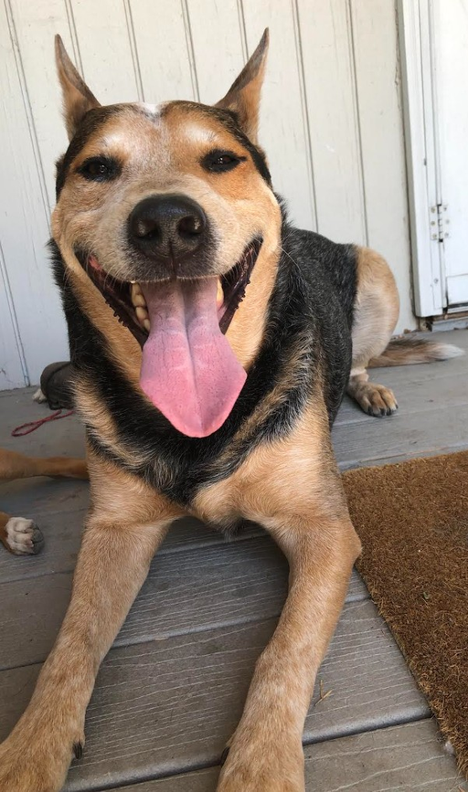

# Dexter: Blue Heeler for Project Zomboid

A community-made **Australian Cattle Dog / Blue Heeler breed add-on** for [Project Zomboid](https://projectzomboid.com/) Build 42, named for Dexter. Adds a custom blue-coat breed to the existing **Companion Dogs** framework without bundling the base mod.

## Requirements

- Project Zomboid **Build 42**. Local metadata targets `42.19.0` with minimum `42.18.0`. Other versions have not been verified here.
- **[Companion Dogs](https://steamcommunity.com/sharedfiles/filedetails/?id=3740052292)** by **Björn**, version **0.7.0 or newer**, with breed API version **3+**.
- Mod ID: `CompanionDogsBlueHeeler`, dependency ID: `CompanionDogs`.

## What this add-on does

- Registers the `blueheeler` breed with the Companion Dogs add-on API.
- Defines puppy, adult male, and adult female animal profiles, stats, coat assets, genetics and farm/house spawn options.
- Supplies a custom coat and portrait textures, bandage/wound variants, translated breed labels and an optional **Cattle Drive** moodle.
- Uses the existing Companion Dogs behaviors, avatar helpers, dog sounds and body model at runtime. The base mod must be installed separately.

### Installation

Copy the **contents of this repository** into a folder named `CompanionDogsBlueHeeler` under your local `Zomboid/mods` directory, keeping the `42/` folder and root `mod.info` in place. Enable **Companion Dogs** first, then **CD: Blue Heeler** from the game's mod manager.

This repository is the add-on source and assets, not a replacement for the upstream mod. **Not playtested or certified on the current game version in this repository audit.**

## APIs and dependencies: explicit credit

This add-on uses two **in-game Lua API surfaces**, not external web services:

1. **Companion Dogs breed/add-on API by Björn**, including `CompanionDogs.registerBreed`, `CompanionDogs.API_VERSION`, `CompanionDogs.defineDogParts`, model/behavior/avatar helpers, `CompanionDogs.DogMoodles`, and related dog-state helpers. Companion Dogs owns these implementations.
2. **Project Zomboid Build 42 Lua and animal definition interfaces by The Indie Stone**, including `AnimalDefinitions`, `AnimalAvatarDefinition`, `CharacterStat`, animal instances, player stats and game runtime callbacks.

**No HTTP API, paid service, cloud credential, or network request is required by this add-on.** External API keys are not shipped.

This is an independent add-on and is **not official or endorsed** by Björn, the Companion Dogs team, or The Indie Stone.

## Credits and permissions

**Companion Dogs: Björn.** The [upstream Steam Workshop description](https://steamcommunity.com/sharedfiles/filedetails/?id=3740052292&l=english) explicitly permits breed add-ons and use of its art **for those add-ons with credit**. This project's texture/model alignment relies on that limited allowance and does not confer permission to use upstream assets in unrelated projects.

**Project Zomboid: The Indie Stone.** The game, built-in APIs and game assets remain their property. See [Project Zomboid's Modding Policy](https://projectzomboid.com/blog/modding-policy/).

This repository packages only the local `CompanionDogsBlueHeeler` directory and does not contain the base Companion Dogs mod or any other unrelated add-on.

See [THIRD_PARTY_NOTICES.md](THIRD_PARTY_NOTICES.md) for the integration and attribution details.

## Project status

- Local source version: **0.1.0**
- Static integrity and metadata tests: `python -m unittest discover -s tests -v`
- The current mod's real-world compatibility, texture provenance and behavior should be tested in-game before Steam Workshop submission.
- The Lua integration code in this repository is supplied as a community add-on, with third-party rights preserved. No blanket license is granted over upstream models, code or assets.
